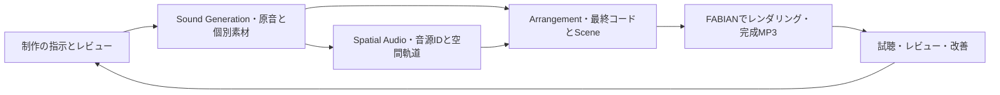

# 構成と運用方針

motionSoundでは、自然言語から1回の操作でヘッドホン向けの空間作品を作る。完成品は48 kHz・2ch・320 kbpsのMP3。

| 責任 | ファイル |
|---|---|
| 制作画面と共通プレーヤー | `frontend/src/App.tsx`、`frontend/src/player.tsx` |
| 履歴・進捗・作品APIと音源配信 | `soundlab/api.py`、`soundlab/catalog.py`、`soundlab/read_model.py` |
| 生成と再試行の調整 | `soundlab/service.py`、`soundlab/jobs.py` |
| 原音の制作計画と合成コード | `soundlab/sound_first.py` |
| 空間設計・アレンジメント・段階別の成果物 | `soundlab/production_layers.py` |
| Python実行、ハッシュ、MP3書き出し | `soundlab/runner.py` |
| 素材検証、空間化、ミックス | `soundlab/spatial/work.py`、`soundlab/spatial/render.py` |
| レビューと保存 | `soundlab/store.py`、`soundlab/memory.py` |

`./start` がReactのビルドを作り、Starletteが画面とAPIを同じローカルポートで配信する。生成を受け付けると先に部屋を履歴へ登録する。APIは同じ部屋の生成操作を直列に処理し、別の部屋は並行できる。進捗取得はSQLiteと保存済み成果物を読み取る。

プレーヤーは部屋の表示と独立し、実行IDまたは段階別の保存IDでMP3と旧WAVを部分読み込みする。波形は保存音源のピーク包絡をFFmpegで抽出し、ファイルの更新日時とサイズを含めたキーでメモリにキャッシュする。

波形は下部の共通プレーヤーで再生対象の音源に表示する。部屋の詳細は生成中に約1秒間隔、待機中に12秒間隔で更新する。操作の完了とウィンドウに戻ったときにも更新される。APIは生成回ごとに候補と実行記録を1つの接続でまとめて読み取る。

起動時にデータディレクトリをロックし、同じデータに対する生成キューは1つのAPIプロセスが持つ。音源の可否はDBの成功記録と保存ファイルの両方で確認する。空間設計の試聴音が欠けている場合は、画面から保存済みSceneと原音素材を使って復元できる。完了した候補の再開で再レンダリングした音源には新しい実行IDを付け、元のレビューは元の実行に保存する。

原音生成はDirect方式が既定。候補ごとにコードとドライ素材の定義を一度のLLM呼び出しで得る。アプリは定義からRunner入力を作り、各素材を重ねた確認用MP3も保存する。比較用のDirector方式では制作計画とコード生成を別々に呼び出す。

Spatial Audioは保存済み素材のID、長さ、音響分析、合成コードと制作計画を参照し、音源ごとの軌道と残響量をSceneにする。Arrangementは原音の制作計画・素材情報・分析値、このScene、空間版の書き出しに使う共通Pythonコードを受け取り、最終実行コードと必要な変更を返す。アレンジメント用Pythonには、実際のドライ素材の作業コピーを渡す。LLMへの入力はコード、設計、素材の分析値と参照情報。音声ファイルの処理はローカルで行う。

Claudeとの聴き比べを選ぶと、同じ生成回に両APIの候補を保存する。制作指示・尺・候補数・対応する候補のseedを揃え、各候補は原音生成からアレンジまで同じAPIを使う。Claudeモデルは生成回の設定に記録する。実際に応答したモデルは各API応答ログに残す。試聴用と完成版のレンダリングはローカルで共通の処理を使う。

最終レンダラーはアレンジメントが出力した素材とSceneを使う。方向は固定頭部のFABIAN実測データ、距離と残響は近似モデル。既存と同じ48 kHz・2ch・320 kbpsのMP3を公開する。

## 保存と再試行

- 原音のAPI要求と応答は `data/rounds/<生成ID>/` に保存する。候補ごとの成果物は `data/candidates/<候補ID>/layers/` の `sound/`、`spatial/`、`arrangement/` に保存する。各試行は別ディレクトリに残る。
- 原音には合成コード、ドライ素材、試聴用MP3、ハッシュがある。空間設計にはAPI要求・応答とScene、アレンジメントにはAPI要求・応答、最終用コード・Scene・素材、変更意図がある。最終音源と実行ログは `data/runs/` にあり、`result.json` から各段階の保存先をたどれる。
- 既存の再試行操作は保存済みの段階を再利用する。未完了の設計があればその段階からLLMを呼び、保存済みコードの実行や最終レンダリングの再試行はローカルで行う。検証用に各段階には個別の実行入口がある。
- 履歴とレビューは `data/history.sqlite3` に保存する。指示を編集して回を置き換えると、前の版の音源と素材を保持する。「ひとつ前に戻す」で前の版を再表示する。APIキーは生成プロセスに渡さない。

新規・改善・やり直しの指示は、生成を受け付けた時点でSQLiteに保存する。再起動後は部屋で指示を確認し、「生成を再開」で実行する。やり直しを受け付けると履歴は新しい回に切り替わり、「ひとつ前に戻す」で前の版を開ける。

生成ワーカーは保存した受付を読み取って動く。初回生成と再開は同じ処理で候補のコード・計画・実行設定を保存する。改善元は選んだ完成音源の実行IDで指定する。旧方式の選択記録が残っている場合は、部屋を削除するときに一緒に取り除く。

生成中は「生成を中止」で待機中のジョブ、APIの応答待ち、ローカルの音声処理を止められる。完成済みの候補や保存済みの段階は部屋に残る。中止後や失敗後は「生成を再開」で未完成の候補を再開し、「この候補を再開」で候補1件だけを処理する。入力ファイルの書き込みが中断した場合は保存済みの生成情報から復元する。再開時のAPIログは別の試行に保存する。

部屋の削除は音源と関連ファイルを消してからSQLiteの記録を削除する。途中で失敗した場合は「削除を再試行」または次回起動時に残りの削除を行う。
